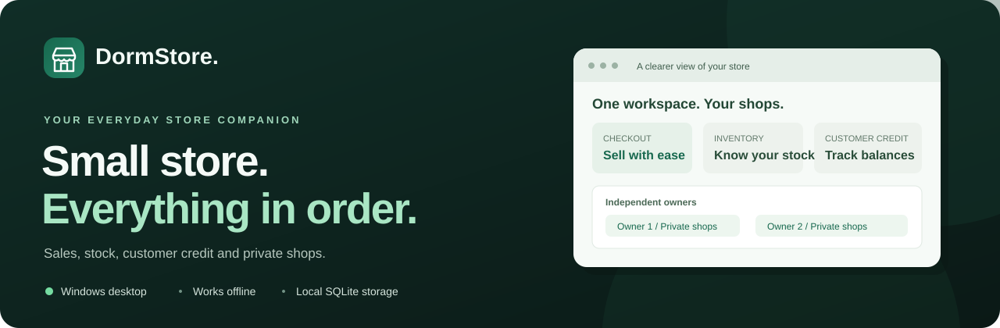
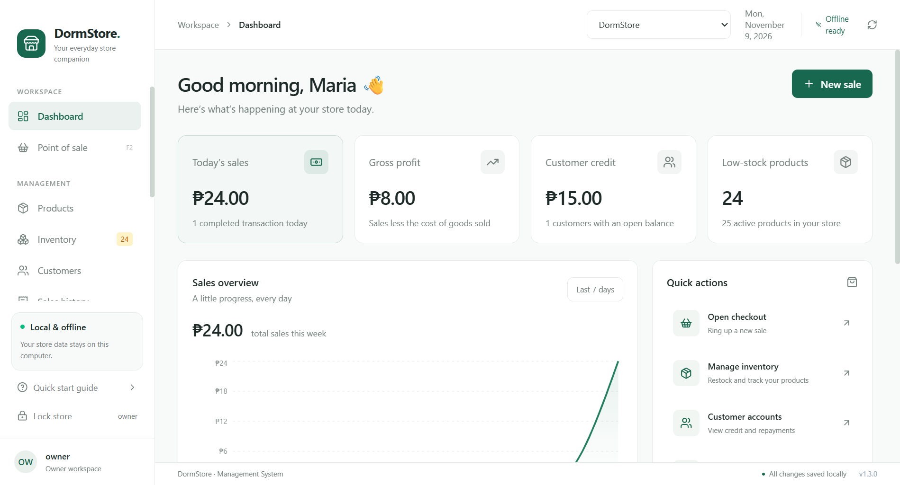
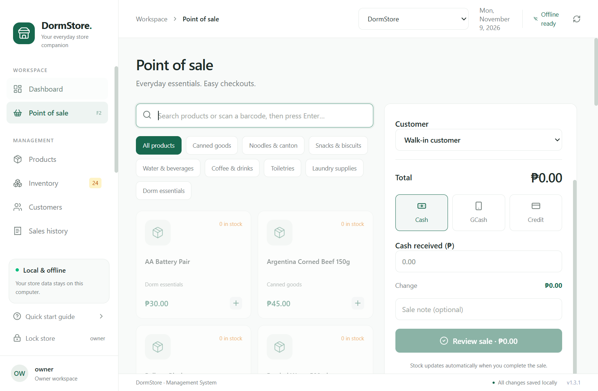
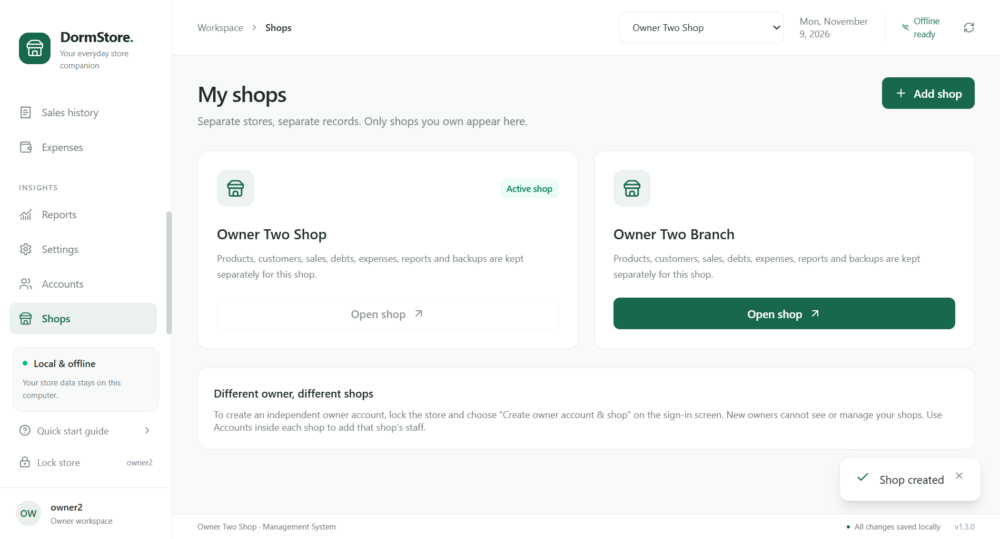
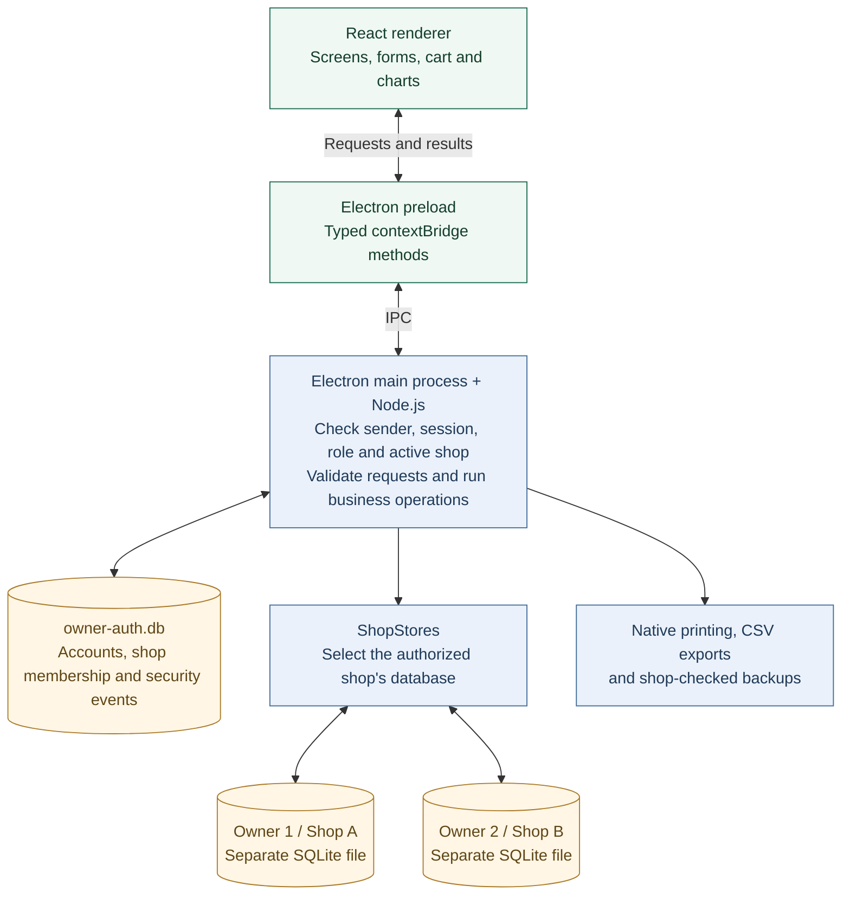

<p align="center">
  
</p>

<h1 align="center">DormStore Management System</h1>

<p align="center">
  An offline desktop point of sale for dormitory sari-sari stores.<br />
  Manage sales, inventory, expenses and customer credit, with private shops for every owner.
</p>

<p align="center">
  <a href="#installation"></a>
  <a href="#installation"></a>
  <a href="#data-and-recovery"></a>
  <a href="VALIDATION.md"></a>
</p>

<p align="center">
  <a href="#preview">Preview</a> ·
  <a href="#features">Features</a> ·
  <a href="#tech-stack">Tech stack</a> ·
  <a href="#how-it-works">Architecture</a> ·
  <a href="#installation">Installation</a> ·
  <a href="#contributing">Contributing</a>
</p>

## Preview



<details>
<summary><strong>See checkout and private shop management</strong></summary>

**Point of sale** — search or scan products, choose a payment method and review the sale.



**My shops** — an owner sees and switches between only their own shops.



</details>

Screenshots use fictional records from isolated desktop tests. A fresh installation starts with empty business records.

## Features

| Sell and collect                            | Manage the business                            | Keep shops separate                          |
| ------------------------------------------- | ---------------------------------------------- | -------------------------------------------- |
| Barcode/SKU search and cash checkout        | Product catalog, restocks and stock history    | Independent owner accounts and private shops |
| Recorded GCash payments and customer credit | Customers, credit limits and repayment ledgers | Staff assigned to one shop                   |
| Printable receipts and whole-sale voids     | Expenses, profit charts and CSV reports        | Separate shop databases, reports and backups |

The installed app works without an internet connection. GCash payments are recorded after external confirmation; DormStore does not connect to GCash. One person uses the workspace at a time on the computer.

## Tech stack

<p align="center">
  <a href="https://www.electronjs.org/"></a>
  <a href="https://react.dev/"></a>
  <a href="https://www.typescriptlang.org/"></a>
  <a href="https://tailwindcss.com/"></a>
  <a href="https://ui.shadcn.com/"></a>
  <br />
  <a href="https://nodejs.org/"></a>
  <a href="https://www.sqlite.org/"></a>
  <a href="https://github.com/WiseLibs/better-sqlite3"></a>
  <a href="https://recharts.org/"></a>
  <a href="https://lucide.dev/"></a>
  <a href="https://www.electron.build/"></a>
</p>

### Application technologies and why we use them

| Technology                                                                                                                            | What it does in DormStore                                                                         | Why we chose it                                                                                                                             |
| ------------------------------------------------------------------------------------------------------------------------------------- | ------------------------------------------------------------------------------------------------- | ------------------------------------------------------------------------------------------------------------------------------------------- |
| [Electron](https://www.electronjs.org/docs/latest/tutorial/process-model)                                                             | Runs the Windows application, manages windows, printing and native file dialogs.                  | Packages a web-based interface as a desktop app with access to the local capabilities a store needs.                                        |
| [React](https://react.dev/)                                                                                                           | Builds the dashboard, checkout, forms, account pages and shop switcher from reusable components.  | Keeps interactive screens manageable and updates the interface as the cart or store records change.                                         |
| [TypeScript](https://www.typescriptlang.org/)                                                                                         | Types the renderer, main process and shared IPC contracts.                                        | Catches mismatched data shapes during development, especially across the UI/database boundary. Runtime validation still happens separately. |
| [Tailwind CSS](https://tailwindcss.com/)                                                                                              | Styles layouts, spacing, colors, typography and responsive controls.                              | Makes it easier to maintain a consistent store interface using shared design tokens and utility classes.                                    |
| [shadcn/ui-style components](https://ui.shadcn.com/docs) + [Radix UI](https://www.radix-ui.com/primitives/docs/overview/introduction) | Local Button and Dialog components use Radix primitives, Tailwind and class variants.             | Gives us editable component code and established dialog/focus behavior while keeping DormStore's own design.                                |
| [Node.js](https://nodejs.org/api/)                                                                                                    | Provides file operations, local backups and password cryptography in the main process.            | Runs backend logic inside the desktop application, so users do not need a separate server. Electron bundles its own runtime.                |
| [SQLite](https://www.sqlite.org/whentouse.html)                                                                                       | Stores products, sales, stock movements, debts and expenses in a separate database file per shop. | Fits a local desktop store: no database server to install, offline persistence and transactions for related writes.                         |
| [better-sqlite3](https://github.com/WiseLibs/better-sqlite3)                                                                          | Connects Node.js to SQLite using prepared statements and transactions.                            | Keeps database code direct and lets checkout update sales, stock and debt together in an atomic transaction.                                |
| [Recharts](https://recharts.org/)                                                                                                     | Displays sales, profit and category charts using local report data.                               | Provides React chart components without adding an external analytics service.                                                               |
| [Lucide React](https://lucide.dev/guide/packages/lucide-react)                                                                        | Supplies the navigation and action icons.                                                         | Keeps icons consistent and bundles the icons used by the app, with no remote icon font.                                                     |
| [Zod](https://zod.dev/)                                                                                                               | Validates incoming account and business data before it is used.                                   | Checks real runtime inputs; TypeScript alone cannot validate requests arriving through IPC.                                                 |
| [Electron Builder](https://www.electron.build/)                                                                                       | Packages production files and the native SQLite module into the Windows NSIS installer.           | Produces an installable app with shortcuts, so store users do not need Node.js or development tools.                                        |

### Development and verification tools

| Tool                                                                    | Purpose and reason                                                                                                    |
| ----------------------------------------------------------------------- | --------------------------------------------------------------------------------------------------------------------- |
| [electron-vite](https://electron-vite.org/) + [Vite](https://vite.dev/) | Develop and build the main process, preload and React renderer with one project configuration.                        |
| [Playwright](https://playwright.dev/docs/api/class-electron)            | Drives the real Electron application to check checkout, login, permissions and shop isolation through the UI and IPC. |
| [Node.js test runner](https://nodejs.org/api/test.html)                 | Runs integration tests against real temporary SQLite databases inside Electron's Node runtime.                        |
| [Prettier](https://prettier.io/)                                        | Keeps source and documentation formatting consistent for contributors.                                                |

Exact dependency versions are recorded in [`package-lock.json`](package-lock.json); scripts and declared dependencies are in [`package.json`](package.json). The badges identify the tools used, rather than live dependency or CI status.

## How it works



For example, **Complete sale** sends the cart through the preload bridge. The main process checks the signed-in user's permissions and shop, validates the request, then writes the sale, stock change and any customer debt in one transaction. The renderer receives the receipt and updated records through the bridge. It cannot open database files directly.

An owner can manage several shops. Staff stay assigned to one shop, and every business request uses the shop selected by the authenticated main-process session. The diagram shows two separate databases; it does not grant either owner access to the other's records.

## Installation

### For store users

If the repository maintainer has published a GitHub Release, download its `DormStore-Setup-1.3.0-x64.exe` installer from the repository's **Releases** section. Run it, choose the installation folder and open DormStore from the desktop shortcut. On first launch, create an owner account and shop, then save your recovery code privately.

The installed application needs no Node.js, npm, database server or internet connection. Windows 10/11 x64 are the configured targets; validation on this workspace was performed on Windows 11. See [the validation record](VALIDATION.md) for hardware and release checks.

### For developers

Clone or download this repository, then open a terminal in its root folder.

Use Node.js 24 LTS and npm on Windows 10/11 x64. Internet is needed to install development dependencies and download build tools; the installed application runs offline.

```powershell
npm.cmd ci
npm.cmd run dev
```

Using `npm.cmd` avoids the PowerShell execution-policy error that can block `npm.ps1`.

Development uses a separate `%APPDATA%/DormStore-dev` profile for its accounts, shop records and browser cache, so it can run alongside the installed application. A first development launch starts with empty records and asks you to create an owner and shop. `DORMSTORE_DATA_DIR`, when set, overrides both the development and installed profiles for isolated testing.

```powershell
npm.cmd run build          # TypeScript checks and production bundles
npm.cmd test               # SQLite integration tests in Electron's Node runtime
npm.cmd run test:desktop   # Actual desktop UI / IPC integration test
npm.cmd run test:shops     # Independent owners, shop switching and isolation checks
npm.cmd run pack           # Unpacked Windows application in release/win-unpacked
npm.cmd run dist           # Windows x64 NSIS installer in release
```

Install the generated `release/DormStore-Setup-1.3.0-x64.exe` on the store computer. The installer allows choosing the installation directory and creates a desktop shortcut. Node.js and npm are not needed by the installed application. The installer preserves store data on uninstall. Existing usernames, passwords, recovery codes and lockout state are retained. If no account exists, first launch asks you to create the initial owner and shop. Downgrading to an older app is unsupported.

When upgrading an existing shared store, the earliest active owner keeps its business records, staff and historical security activity. Every other existing owner keeps their login and receives a new empty private shop. Historical records are never copied between owners. Back up the current store before upgrading and verify the assigned owner before continuing operations.

The native binding is rebuilt by `postinstall`. If native prebuilt binaries are unavailable, Electron Builder may require Visual Studio C++ Build Tools and Python. After updating Electron or better-sqlite3, run `npm.cmd run postinstall` and repeat the tests. The lockfile records the tested dependency versions.

## Daily use

On first launch, enter your shop name, choose your owner username and a password of at least 12 characters. Save the recovery code privately outside this computer, confirm you saved it, then open your store. There is no default username or password. Every new application launch requires sign-in.

For a different business owner, choose **Lock store → Create owner account & shop**. The new account receives an empty private shop and cannot open another owner's shops. One owner can use **Shops → Add shop** to create additional shops and switch using **Active shop** in the header. Switching clears open forms, receipts and drafts, with confirmation when a cart is nonempty. Each sign-in starts in that account's original shop. Store details can be renamed in Settings; products, sales, inventory, customers, debts, expenses, reports and backups remain separate for every shop.

1. Open **Settings**, enter the store and owner details, and save.
2. Open **Products** and add actual products, prices, costs, barcode/SKU, unit, opening stock and low-stock threshold. Alternatively, load the optional 24-product starter catalog from Settings. It contains example prices and **zero stock**; verify prices and restock before selling.
3. Open **Point of sale**, or press **F2**. Search products or scan a barcode/SKU with a keyboard-style scanner and press Enter. Add quantities, choose the customer and payment method, review, and complete the sale.
4. For **Cash**, enter the amount received; the receipt shows change. **GCash** records an externally confirmed payment; it does not connect to GCash. **Credit** requires a named customer and sufficient available credit. An optional down payment is treated as cash received.
5. Use **Customers** to set credit limits, view the full account ledger and record cash/GCash repayments. Outstanding balance is derived from ledger entries. Repayments cannot exceed the balance, and credit limits cannot be reduced below the current balance.
6. Use **Inventory** for restocks, damaged/expired goods, corrections and personal use. Every quantity change has a stock movement. Product editing does not silently overwrite stock.
7. Record operating costs under **Expenses**. Use **Reports** for date-filtered sales, cost of goods, gross/net profit, collections, best sellers and category breakdowns. Export CSV for spreadsheet use.
8. Use **Sales history** to view/print receipts or void a fully returned sale with a reason. Voiding returns stock and reverses that sale's credit; return the customer's paid amount separately. A sale cannot be voided if doing so would make the customer's account negative. A voided sale is retained in history and excluded from reports.

## Accounts, permissions and locking

Owners open **Accounts** in the sidebar to add staff to the active shop, enable/disable those staff, clear their cooldowns and issue replacement temporary passwords. Account changes require the signed-in owner's current password. Another owner registers separately from the sign-in screen; staff cannot be promoted into another shop owner. Owners cannot view or manage another owner's accounts. Usernames are case-insensitive, unique across this installation even for disabled accounts, and cannot be renamed. Accounts are disabled rather than deleted. Up to 100 accounts per shop (including the owner) and 50 shops per owner are supported.

| Role  | Access                                                                                                                                                                                                                                |
| ----- | ------------------------------------------------------------------------------------------------------------------------------------------------------------------------------------------------------------------------------------- |
| Owner | Full store access, financial reports, product costs, stock changes, customer credit limits, expenses, voids, backups, account management and security activity.                                                                       |
| Staff | Checkout, selling-price/stock lookup, customer balances and repayments, shared sales and receipt lookup/printing, and personal password changes. Costs, profit reports, expenses and database paths are withheld by the main process. |

One account uses the workspace at a time on this computer. Staff can access only their assigned shop and cannot switch shops. Use **Lock store** to switch users. A new staff account or an account reset by an owner must replace its temporary password with a different private password before any store data can be accessed. That person receives their own recovery code after changing it. Disabling an account prevents sign-in and recovery; role/status/password changes revoke older session versions. An owner cannot disable their own account or change their own role.

**Accounts → Security activity** shows the latest 300 events for the active shop: sign-ins, failures, cooldowns, permission denials, account/password changes and store mutations, attributed to the signed-in username. Up to 5,000 events per shop are retained. Sign-in events for known users belong to their original shop; anonymous failures are withheld from shop owners. Passwords and recovery codes are never logged.

- **Lock store** in the sidebar signs out immediately. A nonempty cart asks for confirmation before being discarded. Locking clears the visible workspace, open forms and cart; saved records remain.
- The app automatically locks after **10 minutes without interaction**, when Windows locks, or when the computer suspends. Use Lock store before stepping away rather than waiting for the timeout.
- **Settings → Change password** requires your current password and a different new password. It keeps your existing recovery code valid. An owner's reset of someone else's account invalidates their old password and recovery code and forces a private password change on next sign-in.
- **Forgot password?** on the sign-in screen accepts your username and recovery code. A successful reset generates a new recovery code and invalidates the old one. Save the replacement when shown. There is no password-free reset or hidden default account.
- Five failed attempts for the same username trigger a 60-second cooldown, increasing up to 15 minutes. Unknown names receive equivalent tracking, and wrong passwords, disabled accounts, nonexistent accounts and account cooldowns return the same public error. Owners can clear a specific account's failures/cooldown after confirming their own password. Failure records expire after 24 quiet hours.
- All authentication/password/recovery requests share a **20-request rolling 60-second limit for the application**, including invalid inputs and rotating usernames. Successful sign-in does not reset this global quota. Account cooldowns and this request history persist across restarts. These are local-device limits, not IP-based web limits: the app has no authentication server.
- Protected store commands have an additional **120-request / 10-second application burst limit**. That short in-memory burst counter resets on process restart; authentication counters remain persistent. Only one costly password operation runs at a time.
- Store reads, sales, stock changes, expenses, customer accounts, reports, backups and receipt printing are checked in the Electron main process. Hiding the sign-in screen does not grant access to those operations.
- Passwords are hashed with a random 32-byte salt using Node.js scrypt (`N=131072`, `r=8`, `p=1`, 64-byte output). The random 256-bit recovery code is stored only as a SHA-256 digest. No plaintext password or recovery code is written to the database or app logs. Parameters follow [OWASP password storage guidance](https://cheatsheetseries.owasp.org/cheatsheets/Password_Storage_Cheat_Sheet.html) and use [Node.js cryptography APIs](https://nodejs.org/api/crypto.html).
- Credentials, authentication limits and security activity are kept in `owner-auth.db` beside the business database. Sessions exist only in the main process's memory. Restoring a business backup cannot revert accounts, roles, passwords or authentication limits. Business backups do not transfer accounts; retain account credentials and recovery codes separately.

Authorization is denied by default and checked in the Electron main process for each protected request. Owner-only controls are also hidden from staff. The approach follows [OWASP authorization guidance](https://cheatsheetseries.owasp.org/cheatsheets/Authorization_Cheat_Sheet.html) and [authentication guidance](https://cheatsheetseries.owasp.org/cheatsheets/Authentication_Cheat_Sheet.html).

This login controls access through DormStore. Business database files and backups remain unencrypted. Protect your Windows account and file access as well, since someone who can directly read or replace local files can bypass an application-level login.

## Data and recovery

The active database path is displayed in Settings. Records live inside the application's Windows user-data profile under `%APPDATA%`:

```text
<application user-data profile>/data/dormstore.db
<application user-data profile>/data/shops/<shop UUID>/dormstore.db
<application user-data profile>/data/owner-auth.db
```

The SQLite database uses foreign keys, WAL mode, full synchronous durability, schema versioning and parameterized queries. Currency is stored as integer centavos. Each checkout, repayment, adjustment and void is atomic. A second running app instance focuses the existing window. Receipts retain the name, price and cost captured at sale time. Updates, voids and deletions leave an audit record in `audit_log`.

A separate SQLite file is selected by the authenticated account and active shop in the main process. The original shop retains `data/dormstore.db`; other shops use the UUID subdirectories. The authentication database holds owner/shop membership, credentials and security events. Requests cannot supply a different shop's database path or override the authenticated shop. This follows [OWASP multi-tenant isolation guidance](https://cheatsheetseries.owasp.org/cheatsheets/Multi_Tenant_Security_Cheat_Sheet.html).

When a shop is first opened each day, a backup is created in `backups/auto-YYYY-MM-DD.db` beside that shop's database. Automatic backups remain on the same computer and are not automatically pruned. Use **Save a backup** to save a consistent SQLite snapshot to a USB drive or separate disk. Manual backup and CSV destinations must be outside the application's managed data folder to protect other shops and credentials. Prefer this over manually copying an open WAL database.

**Restore a backup** verifies shop identity, SQLite integrity, schema version, foreign keys and application queries before replacing records. Backups from another shop are rejected. Old backups without a shop identity can be restored only into the original migrated shop. Restoration requires confirmation and first saves `before-restore-TIMESTAMP.db` alongside the active database. A successful restore clears the checkout cart. Business backups preserve the shop identity and do not recreate accounts on a new installation; moving to another computer requires the whole application data folder and a separate secure Windows transfer. Keep backups private because they include customer information.

For isolated development/testing only, set `DORMSTORE_DATA_DIR` to a separate folder before launching. It overrides the app profile and database location. Desktop tests use a fresh folder under `test-output/` and never touch normal store records. Test screenshots and results are saved there.

## Application structure

```text
electron/index.ts          Main lifecycle, origin-checked IPC, dialogs, export, printing
electron/preload.ts        Explicit typed contextBridge methods
electron/auth.ts           Account migration, password/session management, persistent limits and security activity
electron/access.ts         Staff data redaction for snapshots and receipts
electron/store.ts          Schema, database transactions, reports, backup/restore
electron/shops.ts          Authorized per-shop databases, daily backups and output path guards
docs/images/              README banner and screenshots from isolated test profiles
shared/contracts.ts       Renderer/main DTOs
shared/validation.ts      Zod validation at the database boundary
shared/permissions.ts     Explicit owner/staff command allowlists
src/pages/                Dashboard, POS, products/inventory, accounts, sales, expenses, reports, settings
src/components/ui/        Local shadcn/ui-style Button and Radix Dialog primitives
tests/store.test.ts        Database and recovery integration tests
tests/auth.test.ts         Password, cooldown, session and authentication backup-isolation tests
tests/accounts.test.ts     Roles, multiple accounts, migration, rate limits and redaction tests
tests/shops.test.ts        Owner/shop isolation, legacy migration and scoped backup tests
scripts/e2e.mjs            Real Electron workflow, isolation and layout checks
scripts/shops-e2e.mjs      Independent owners, multi-shop UI, staff and file isolation checks
```

The renderer has no Node.js integration or direct database/file access. Context isolation and renderer sandboxing are enabled. The preload exposes individual operations, not raw `ipcRenderer`. Main-process handlers validate the sender/frame and database inputs. New windows, unexpected navigation and permission requests are denied. Production assets and fonts are local; no CDN, analytics, remote API or updater is used. The production CSP disallows inline scripts; local Vite development permits its injected script preamble. See [Electron security guidance](https://www.electronjs.org/docs/latest/tutorial/security) and [context isolation](https://www.electronjs.org/docs/latest/tutorial/context-isolation).

## Operational limits

- Intended for multiple private shops on one computer, with one signed-in account at a time. There is no cloud sync or simultaneous use across computers. A local login protects app access; Windows account security protects direct file access. Database encryption is not implemented. A shop's sales/receipt history and customer balances are available to its staff for customer service.
- This is an operational sales and inventory tool. Printed records are labeled **not a BIR tax invoice**. Tax filing, regulatory certification and fiscal-invoice integration are outside this implementation.
- Entire-sale voids are supported; partial returns and electronic refunds are not implemented. GCash confirmation and refunds happen outside DormStore.
- Current stock uses units, not lot/expiry tracking. Costs use the product's configured unit cost when sold, not FIFO or weighted-average costing. Adjustments do not automatically create financial loss expenses.
- Net profit is sales less captured cost of goods and recorded operating expenses. Do not also expense stock purchases, or cost will be counted twice. Collections include applied sale payments and debt repayments in the selected period. Voids remove the original sale's totals rather than creating a dated cash-refund ledger.
- Sales history displays the latest 500 sales, and stock history the latest 300 movements. Reports query all stored sales. Customer ledgers retain the full account history. Reports accept a maximum 367-day date range. Category reports use each product's current category.
- Draft carts remain available while navigating during a session. Closing with a nonempty cart asks whether to discard it. Draft carts are not persisted across process termination.
- The Windows installer is unsigned until a trusted signing certificate is configured. A release for public distribution needs code signing and testing on the target Windows versions and printer hardware. [Electron Builder NSIS configuration](https://www.electron.build/nsis/) documents installer options.

See [VALIDATION.md](VALIDATION.md) for the checks completed in this workspace and remaining release checks.

## Contributing

Bug reports, documentation improvements and code contributions are welcome. Use the repository's **Issues** tab for reproducible bugs or feature suggestions, and **Pull requests** for proposed changes. Include the Windows version, app version, steps to reproduce and expected behavior. Use fictional records in examples and screenshots.

For code changes, run the relevant checks before submitting:

```powershell
npm.cmd run typecheck
npm.cmd test
npm.cmd run test:desktop
npm.cmd run test:shops
```

The desktop suites create isolated test profiles. Explain the behavior changed and the checks completed in your pull request. Report authentication or data-isolation weaknesses privately to the maintainer rather than posting customer records or credentials in a public issue.

## License

A project license has not yet been selected. The repository should include a `LICENSE` file with the maintainer's chosen terms before it is offered for public reuse; see [GitHub's licensing guide](https://docs.github.com/en/repositories/managing-your-repositorys-settings-and-features/customizing-your-repository/licensing-a-repository). Third-party dependencies retain their own licenses.
